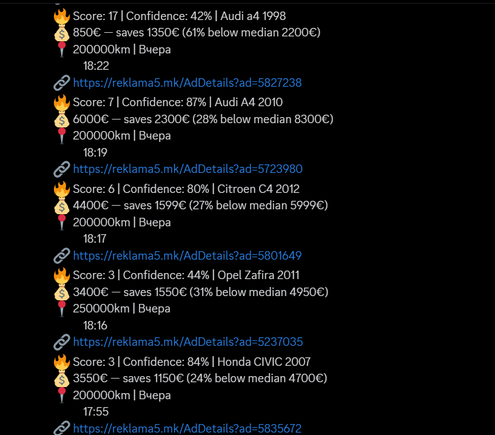

# 🚗 MK Car Tracker
> Automated car deal hunter for [Reklama5.mk](https://reklama5.mk) — scrapes listings, scores deals using statistical analysis, and fires real-time alerts to Discord.


---
## 💡 Motivation

My father and I wanted to get into car flipping, but spotting underpriced listings on Reklama5.mk meant refreshing the site manually all day. I built this tool to do that automatically — scraping the full market, scoring every deal against real price data, and alerting us on Discord the moment something worth buying appears.

---
## 📊 Results
Running the tracker regularly between March and September 2026:
- **15,000+ listings** collected across **54 makes** and **1,000+ models**
- **861 deals flagged**, priced on average **~33% (≈ €2,500) below** the median of comparable cars

**Real Discord alerts from a run:**



<!-- TODO: add a console screenshot and uncomment

-->

---
## ✨ Features
- **Full market scraping** — crawls every car listing on Reklama5.mk across all pages
- **Smart deal scoring** — compares each listing against a trimmed median of similar cars (same make, model, ±2 years, ±50,000 km)
- **Statistical confidence** — scores are weighted by sample size and market volatility, so noisy markets don't trigger false positives
- **Outlier trimming** — top and bottom 10% of prices are discarded before calculating the median to remove fake or inflated listings
- **Discord alerts** — instant notifications with price, savings, mileage, and a direct link to the listing
- **Duplicate prevention** — SQLite database ensures you're never alerted twice for the same deal
- **Two scraping modes:**
  - `Mode 1` — send ALL deals found, including previously seen ones (good for a fresh database run)
  - `Mode 2` — send only NEW deals never seen before (good for scheduled/repeated runs)
---
## ⚙️ How It Works
### 1. Scraping
The scraper paginates through Reklama5.mk's car category, parsing each listing for:
- **Make & model** — resolved via a normalization map (e.g. `VW` → `Volkswagen`)
- **Year, mileage, horsepower, price**
- **Listing URL & date posted**
All valid listings are stored in a local SQLite database (`cars.db`).
### 2. Deal Detection
For each listing, the script queries the database for comparable cars:
- Same make and model
- Year within ±2 years
- Mileage within ±50,000 km
If at least **5 comparable listings** exist, it calculates:
```
trimmed_median  = median of middle 80% of prices
saving_pct      = (median - price) / median * 100
deal_score      = saving_pct - (km / 10,000)     # penalises high mileage
confidence      = (1 - e^(-n/15)) × volatility_factor
final_score     = deal_score × confidence
```
A listing is flagged as a deal if:
- Price is **below 80% of the median**
- Saving is **more than €1,000**
- Final score is **positive**
### 3. Discord Notification
Deals are posted to your Discord channel via webhook in this format:
```
🔥 Score: 18 | Confidence: 74% | Volkswagen Golf 2018
💰 4200€ — saves 1800€ (30% below median 6000€)
📍 142000km | 15.03.2025
🔗 https://reklama5.mk/...
```
---
## 🛠️ Installation
```bash
# Clone the repo
git clone https://github.com/DimitarKlifov/mk-car-tracker.git
cd mk-car-tracker
# Install dependencies
pip install -r requirements.txt
```
Set your Discord webhook as an environment variable:
```cmd
# Windows
setx DISCORD_WEBHOOK "https://discord.com/api/webhooks/..."
```
```bash
# Linux / macOS
export DISCORD_WEBHOOK="https://discord.com/api/webhooks/..."
```
Then open a **new terminal** and run:
```bash
python car_tracker.py
```
---
## 📁 Database Schema
Two tables are created automatically in `cars.db`:
**`listings`** — every scraped car
| Column | Type |
|---|---|
| make, model | TEXT |
| year, km, hp, price | INTEGER |
| listing_url | TEXT (unique) |
| date_posted | TEXT |
**`deals`** — every detected deal
| Column | Type |
|---|---|
| make, model | TEXT |
| year, km, price, median_price | INTEGER |
| deal_score, confidence | INTEGER |
| listing_url | TEXT (unique) |
| date_found | TEXT |
---
## ⚠️ Known Limitations
- **Site access** — Reklama5.mk now protects its search pages with Cloudflare, which blocks automated requests (HTTP 403). The scraper detects this and stops with a clear message instead of crashing.
- **Placeholder prices** — some sellers list symbolic prices (e.g. 666€, 777€, 1111€) instead of the real one. These pass the minimum price filter and can show up as false "deals".
- **HTML parsing** — the scraper depends on Reklama5's page structure; if the site layout changes, the CSS selectors need to be updated.

## 🔭 Future Improvements
- Filter out placeholder prices (repeated digits, round "call me" values)
- Track price history per listing to detect price drops
- Run on a schedule (cron / Task Scheduler) instead of manually
- Simple web dashboard to browse deals and market prices
- Unit tests for the parsing and scoring logic

---
## 📄 License
MIT — see [LICENSE](LICENSE) for details.
